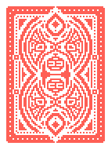
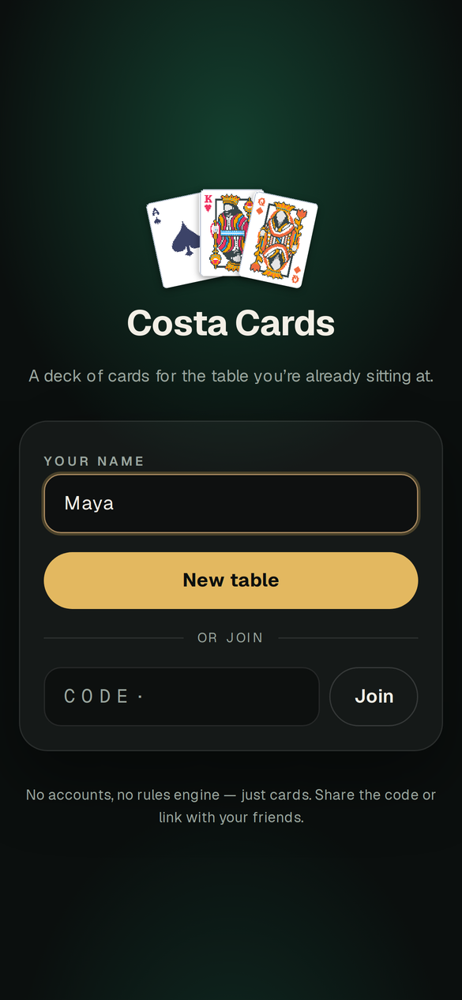
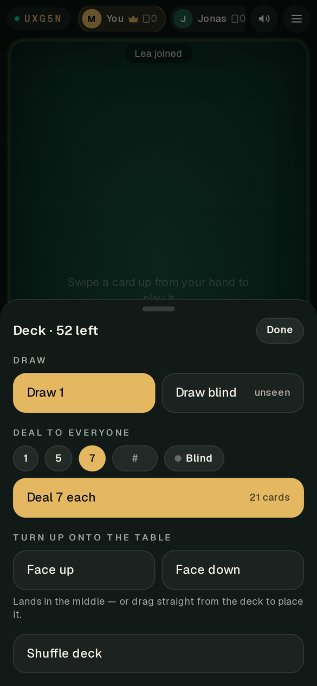
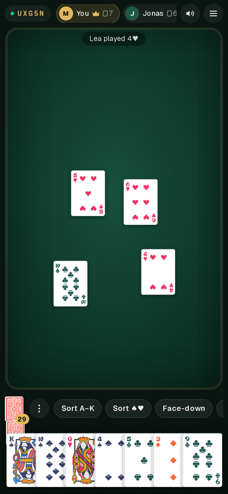

#  Costa Cards

A deck of cards that lives on everyone's phone. Made for the moments you're traveling with friends and nobody packed a deck: a long layover, a hostel common room, a night train.

There are no built-in rules. Costa Cards gives you a shared table, a private hand, and a real deck, and the group plays whatever it wants: Poker, President, Crazy Eights, Rummy, Shithead, or something you made up at the gate.

<p align="center">
  
  
  
</p>

## Features

- **A real deck.** Draw, deal round-robin, deal to the table, shuffle, and recycle a discard pile back into the deck. Choose 52 cards, 54 with jokers, or two decks.
- **A shared table.** Drag cards anywhere. Cards dropped close together snap into piles, and piles can be taken, flipped, moved, or collected.
- **Private hands.** Play cards face-up or face-down. Hidden cards stay hidden, even from someone digging through browser dev tools.
- **Built for phones.** An overlapping hand fan, instant drags, shield mode for crowded seats, and the screen stays awake while you play.
- **Forgiving connections.** Lock your phone or lose signal in a tunnel and your seat and hand wait for you for 15 minutes. Rooms survive the server sleeping.
- **Easy to join.** Share a QR code or link. Up to 8 players per room.
- **Private by default.** An optional group passcode keeps strangers out, and room links are hidden from search engines.

## How to play

1. Open the site, enter your name, and create a room.
2. Invite friends with the QR code, the link, or the five-letter room code.
3. Tap the deck to draw. The host deals, shuffles, and resets, or lets everyone do it with **Anyone can deal**.
4. Drag a card up out of your hand to play it. Drag table cards to move them, or onto your hand to pick them up.
5. Tap a pile for pile actions: take it, flip it, move it, or shuffle it back into the deck.

## Running locally

```bash
npm install
cp .env.example .env.local
npm run dev
```

This starts the app at [localhost:3000](http://localhost:3000) and the PartyKit room server at `127.0.0.1:1999`. To run them separately, use `npm run dev:next` and `npm run dev:party`.

```bash
npm test         # domain, protocol, and sync tests
npm run lint
npm run build
```

## Deploying

Both halves run on free tiers.

**1. Room server (PartyKit)**

```bash
npx partykit login
npm run deploy:party
```

Note the host it prints, such as `costa-cards.<you>.partykit.dev`.

**2. Web app (Vercel)**

```bash
npx vercel
```

Set `NEXT_PUBLIC_PARTYKIT_HOST` to your PartyKit host in the Vercel project settings, then redeploy.

**Optional: group passcode**

```bash
npx partykit env add ROOM_PASSCODE
npm run deploy:party
```

Players enter the passcode once and their device remembers it. To try it locally, run `npx partykit dev --var ROOM_PASSCODE=secret`.

## How it works

The PartyKit server is the single source of truth. Each room is one PartyKit party. All game logic lives in a pure TypeScript domain that the server runs on every action, and each player gets a private snapshot that never includes the faces of hidden cards. The client applies your own moves right away and reconciles when the server confirms them.

```
party/server.ts    Room server: connections, persistence, cleanup alarms, passcode
src/domain/        Game logic, table geometry, sprite atlas, and tests
src/lib/           Protocol types, message validation, optimistic sync
src/hooks/         Room connection, drag engine, wake lock
src/components/    Table, hand, sheets, and screens
src/app/           Next.js pages and app metadata
public/cards/      Card sprite sheets
CORE.md            Product spec
```

**Stack:** Next.js 16, React 19, Tailwind CSS 4, PartyKit, Vitest.

## Notes

- A player's cards go back into the deck when they leave, are removed by the host, or stay disconnected for more than 15 minutes. Empty rooms are deleted after 2 hours.
- If `next dev` ever starts spawning hundreds of processes, check that Next.js is on 16.3.x and delete `.next/dev`.
- The card art is Balatro-style pixel art used for personal play. Check the licensing before any public or commercial use.
